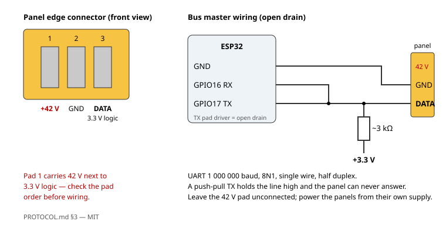

# LeafBus

Drive Nanoleaf Shapes light panels directly over their panel bus — no stock controller, no cloud, no app.


*Layout computed from the bus alone: numbers are chunk indices, dots mark the connector each panel is reached through (
green: where the ESP32 is attached), the blue ring is the power supply.*

An ESP32 replaces the Shapes controller on the three-pin edge connector, enumerates the panels, reads their layout and
pushes color frames at up to
20 frames per second from MicroPython. On its own it plays effects that follow the shape of your assembly, reacts to
touch, runs a schedule and starts the effect of your choice at power-up; a web interface on the board controls all of it.
The assembly also appears on the network as a pixel sink for DDP and E1.31/sACN,
so any lighting software — xLights, LedFx, Hyperion, WLED sync, a few lines of Python — can play on it. The protocol
itself is documented in [`PROTOCOL.md`](PROTOCOL.md); this repository is its **reference implementation**: written for
correctness and readability, not for speed: a C implementation runs the same bus at 40 frames per second.

## Status

| feature                                                        | status                                          |
|----------------------------------------------------------------|-------------------------------------------------|
| enumeration, layout string, tree, chunk order                  | ✅                                              |
| panel coordinates and orientation from the layout string alone | ✅ Mini Triangle and Triangle; Hexagon layout strings parse, geometry untested |
| color per panel (RGBW + transition time), brightness           | ✅                                              |
| touch events, hot-plug detection and re-enumeration            | ✅                                              |
| DDP and E1.31 receivers, HTTP topology server                  | ✅ E1.31 unicast and multicast                  |
| on-board effects, presets, startup effect, touch actions, schedule | ✅ 20 fps with touch polling on 8 Mini Triangles; schedule tested on the host only |
| web interface on the board                                     | ✅ on the LeafBus firmware image (`tools/build_firmware.sh`) |
| power supply location                                          | ✅ read from the layout string                  |
| Elements, Lines, Canvas, Hexagon on hardware                   | ❌ not tested                                   |
| panel firmware update                                          | ❌ out of scope                                 |

## The protocol

**[`PROTOCOL.md`](PROTOCOL.md) is the main result of this project.** It is a self-contained specification — physical
layer, framing, timing, enumeration, the layout string grammar and the geometry derived from it — with a minimal working
sequence you can reproduce in an afternoon.

## Hardware

- Nanoleaf Shapes panels with their own power supply (42 V). Verified with 13 Mini Triangles and one Triangle, and
  with assemblies of 20 and 26 Triangles and Mini Triangles.
- ESP32 (original, e.g. ESP32-D0WD; the S2/S3/C3 need a different GPIO register base, see `firmware/panelbus.py`).
- One resistor, 1–2 kΩ.
- Something to reach the panel's DATA and GND pads: a spare linker with wires soldered on, or pogo pins.



The supply pad next to DATA carries **42 V**; double-check the pad order before wiring and leave that pad alone.

The TX pin **must** be open drain; a push-pull output holds the line high and the panels can never answer. The firmware
sets the pad mode itself.

## Quick start

1. Build the LeafBus firmware image — MicroPython v1.29 with the LeafBus modules frozen in (no root / admin rights;
   the first run fetches ESP-IDF and its toolchain, ~3–4 GB, later builds take a minute or two). On Linux or WSL:
   ```
   tools/build_firmware.sh
   ```
   On Windows, natively (from PowerShell or cmd, not Git Bash; needs git and Python on PATH):
   ```
   powershell -ExecutionPolicy Bypass -File tools\build_firmware.ps1
   ```
   Both build the board in `firmware/board/LEAFBUS` and patch MicroPython first (`tools/patch_micropython.py`).
2. Connect the ESP32 by USB and install (`pip install -r requirements-dev.txt` first):
   ```
   python tools/deploy.py --flash
   ```
   This writes `dist/leafbus-esp32.bin` with esptool, then uploads `main.py` and the gzipped web UI with
   [mpremote](https://docs.micropython.org/en/latest/reference/mpremote.html). Only the firmware area of the flash is
   written: `config.json`, presets and state on the board survive, so the same command updates a board.
3. The board resets, finds the panels and starts playing at once — Wi-Fi is not needed for that. Without Wi-Fi
   details it opens an access point **LeafBus-XXXX** (password `leafbus1`): join it, open http://192.168.4.1 and enter
   your network under *Settings → Wi-Fi*. You can also put them in a `config.json` beforehand
   (`cp firmware/config.example.json firmware/config.json`, then `tools/deploy.py --flash --config firmware/config.json`).
4. On your network the board prints its address and answers at **http://leafbus.local**:
   ```
   panels: 14
   playing: rainbow (preset Rainbow)
   Wi-Fi  your-network
   Web UI http://192.168.1.42  (http://leafbus.local)
   DDP    udp://192.168.1.42:4048
   E1.31  udp://192.168.1.42:5568  universe 1  group 239.255.0.1
   ```
   If the network goes away later the access point comes back after 20 s, so the board is never unreachable.

**Why a custom image.** A plain ESP32 (no PSRAM) has roughly 200 kB of RAM for MicroPython, Wi-Fi and TCP together.
Copied as files, the LeafBus modules take ~70 kB of it as bytecode; MicroPython's heap then grows into the memory
the network stack needs, and the web server stalls for minutes at a time while the lights carry on. Frozen into the
image, the code runs from flash and every request is answered in 0.1–0.2 s. On stock MicroPython,
`python tools/deploy.py` (without `--flash`) still installs the modules as precompiled `.mpy` files — fine for the
lights and touch, unreliable for the web interface unless the board has PSRAM. Even a single large module such as
`app.mpy` copied onto the filesystem of a board running the image leaves too little memory for Wi-Fi to start.

**Memory on a plain ESP32.** MicroPython and Wi-Fi / TCP share ~200 kB. Stock MicroPython starts with a 56 kB heap,
grows it into the ESP-IDF heap whenever a collection cannot satisfy an allocation and gives areas back once they are
empty. Wi-Fi and lwIP fill freed memory with queued packets at once; when Python takes it back the network starves —
sends block, `select()` fails (EIO), with large assemblies the station can even drop off. The LeafBus image
(`firmware/board/LEAFBUS`, `tools/patch_micropython.py`) fixes the split instead: the Python heap grows once, while
the app starts, to 112 kB and keeps it; it never grows into the last 32 kB of free ESP-IDF memory. Measured with 26
panels, against stock MicroPython:

| | stock | LeafBus image |
|---|---|---|
| a request every 0.5 s, all endpoints, 170 s | 3–14 failed | 0 failed |
| rescans (`POST /api/layout/rescan`), idle / under load | 6/10, 5/10 | 10/10, 10/10 |

Smaller lwIP and Wi-Fi buffers, and an ESP-IDF without SoftAP, were tried and are not used (reasons in
`firmware/board/LEAFBUS/sdkconfig.leafbus`). The app helps itself, too: a rescan frees the old layout before
computing the new one, and a momentary lack of network memory is waited out instead of counted as an error
(`net_starved` in `/api/info`). `"debug": true` and `/api/info` (`idf_heap`: free, largest block, lowest ever) show
the margin.

**Developing.** Files on the board's filesystem take precedence over frozen modules: to try a change without
rebuilding, upload just that module (`mpy-cross -march=xtensawin firmware/web.py`, then
`mpremote cp firmware/web.mpy :`). `deploy.py --flash` removes such overrides again. `"debug": true` in the settings
prints one status line per second on the serial console (frame rate, HTTP counters, both heaps).

## Web interface

Open the board's address in a browser. The page is self-contained (no Internet needed) and works on phones.

| tab      |                                                                                                                                                                                                                                                    |
|----------|----------------------------------------------------------------------------------------------------------------------------------------------------------------------------------------------------------------------------------------------------|
| Play     | live picture of the panels in their current colors, power, brightness, sleep timer; 13 effects with their settings (palettes, speed, direction, …); presets to save and recall; *Freeze* turns the current picture into a scene you paint panel by panel |
| Layout   | the assembly as computed from the bus, with chunk numbers, controller connector, power supply and the bus tree; rotate / mirror it to match your wall (effects follow this view); per panel: name, keep dark, identify, simulate a touch, own touch actions |
| Schedule | turn on, off, to a preset or a brightness at set times and weekdays (clock from NTP, timezone in Settings)                                                                                                                                             |
| Settings | what plays at power-up, touch actions, network streams, Wi-Fi with network scan, access point, hostname, timezone, ports and pins, board status, reboot                                                                                                  |

**At power-up** the board plays, as configured under *Settings → On power-up*:

* *Resume* (default) — whatever played before, at the same brightness; it stays off if it was off;
* *Always play a preset* — e.g. "Warm white" every time the wall switch is flipped (also from a preset's ⋯ menu: *Play
  on power-up*);
* *Stay dark*.

**Effects** use the geometry from the layout string: Solid, Scene (a color per panel), Rainbow, Flow (palette across
the assembly — horizontal, vertical, diagonal, radial, spinning or in chunk order), Plasma, Colour cycle, Mosaic,
Breathe, Twinkle, Fire (hottest at the bottom), Ripple (waves through neighbouring panels), Wander (lights walking
from neighbour to neighbour) and Sunrise (for wake-up schedules). Slow effects use the panels' own fades, so they stay
smooth at the interpreter's frame rate. Adding one is a class in `firmware/effects.py`; the UI builds its controls
from the parameter list.

**Touch**: tap a panel to make the effect react (Ripple, Twinkle, Wander), hold it for 0.8 s to switch the panels off
and on. Tap and hold can be set to next/previous preset, power, brightness steps or a particular preset — for all panels
or per panel.

**Network streams** take over while DDP / E1.31 frames arrive and hand the panels back to the effect 3 s after the
last frame.

The JSON API behind the page is listed at the top of `firmware/web.py` (`/api/state`, `/api/effects`, `/api/presets`,
`/api/layout`, `/api/settings`, …); the endpoints of the first version (`/layout`, `/state`, `/identify/N`,
`/brightness/N`, `/off`) still work.

## Home Assistant

`custom_components/leafbus/` is a Home Assistant integration (local polling, no cloud). Each board becomes one device
with three entities:

| entity                       | does                                                                                                                         |
|------------------------------|------------------------------------------------------------------------------------------------------------------------------|
| `switch.<name>_power`        | panels on / off — off fades to dark, on resumes what was playing                                                             |
| `select.<name>_sleep_timer`  | 15 min … 8 h switches the panels **on** and turns them off after that long; *Off* cancels the timer and leaves the power as it is |
| `select.<name>_preset`       | the presets saved on the board; choosing one plays it (and turns the panels on). Empty while something else plays — an effect changed in the web UI, or a DDP / E1.31 stream |

Install with [HACS](https://hacs.xyz) (*Custom repositories* → this repository, type *Integration*) or copy
`custom_components/leafbus` into Home Assistant's `config/custom_components/`, restart, then *Settings → Devices &
services → Add integration → LeafBus* and enter the board's address (`leafbus.local` or its IP). A board that later gets
a new address is updated by adding it again, or with *Reconfigure*. The state is polled every 5 s; changes made from
Home Assistant show at once. Boards on firmware older than this repository's work too, but are identified by hostname
rather than MAC address and show a sleep timer set elsewhere as the nearest length.

Tests run a real Home Assistant core (Python 3.14, `pip install pytest-homeassistant-custom-component`):

```
pytest ha_tests -o asyncio_mode=auto
LEAFBUS_LIVE=192.168.1.42 pytest ha_tests/test_live.py -o asyncio_mode=auto
```

The second drives a real board through every entity and puts back what was playing.

## Layout designer

`designer/` plans an assembly before it goes on the wall: place Hexagons, Triangles and Mini Triangles on a grid where
they snap edge to edge, then see how to connect them. It is a plain web page with no build step and no Internet
access needed — open `designer/index.html` in a browser, or serve the folder
(`python -m http.server --directory designer`) and open http://localhost:8000.

- **Design**: click to place (Triangles point up or down depending on where you click), drag to paint several, drag
  to move, R / Shift+R rotate by 60°, F mirrors, Del or right-click removes, Ctrl+Z / Ctrl+Shift+Z undo and redo,
  Ctrl+D duplicates, 0 fits the view. Overlaps are hatched red; panels that do not touch the rest are flagged.
- **Sizes** (D): the overall width and height of the finished design, and the **start panel** — the one nearest the
  middle — with the distances from its centre to the left, right, top and bottom edges. Mount that panel first and
  work outwards, knowing exactly where on the wall the design will end. Select a single panel to measure from it
  instead; cm or inches.
- **Connections** (C): the best place for the controller (fewest hops from the controller to the farthest panel, or
  the lowest edge if the outlet is below), the bus tree with one linker per panel after the first, optional extra
  linkers wherever panels touch (more power paths, a stiffer assembly; the panels ignore the extra data loop, see
  PROTOCOL.md §7.7), and how many power supplies the wattage needs and where they keep every panel closest to a
  supply. Every panel shows its hop count; *Place…* puts the controller or a supply somewhere else by hand and shows
  what that costs.
- **File**: examples, save / open as JSON, a share link that carries the whole design, a 1:1 **wall template** (SVG in
  millimetres: panel outlines, linker positions, controller, supplies, the start panel and its distances), and
  **Load from a LeafBus board**, which imports the assembly as the panels report it (`/api/layout`), with the
  controller and supply where they actually are.

Power figures default to Nanoleaf's spec sheets — a 42 W supply; Hexagon 2 W, Triangle 1.5 W, Mini Triangle 0.54 W
(21, 28 or 77 panels per supply) — and can be changed in the page. The layout logic is `designer/model.js`, tested with
`node --test designer/test` (including imports of real layout strings checked against `firmware/geometry.py`).

## Host tool

`tools/leafbus.py` talks to the board over the network, e.g. to stream from your computer:
```
tools/leafbus.py send 192.168.1.42 red
tools/leafbus.py layout 192.168.1.42 --json layout.json --svg layout.svg
tools/leafbus.py rainbow 192.168.1.42 --layout layout.json
```

The tool needs nothing beyond the standard library for DDP; `--e131` uses the [`sacn`](https://pypi.org/project/sacn/)
package (`pip install -r requirements.txt`).

`layout` prints the assembly tree, which chunk index belongs to which panel, where the power supply is, and draws the
picture at the top of this page.
`identify <ip> N` lights one panel so you can match indices to the wall. With `--layout` the rainbow's hue follows the
angle around the assembly instead of the chunk index.

`tools/simulator.py` runs the real firmware (effects, web UI, API) on your computer with simulated panels, at
http://localhost:8080 — for working on effects or the page without flashing. `--layout <hex>` takes the layout string
of your own assembly, as shown in the Layout tab.

From the REPL, without the network:

```python
import panelbus
import anim

bus = panelbus.PanelBus()
bus.enumerate()
bus.brightness(255)
bus.set_color(255, 0, 0)  # every panel red
bus.push_colors([(255, 0, 0), None, (0, 0, 255)])  # per panel; None = unchanged

anim.rainbow(bus)
```

## Repository

| path                 |                                                                                                                                                                                                                                               |
|----------------------|-----------------------------------------------------------------------------------------------------------------------------------------------------------------------------------------------------------------------------------------------|
| `PROTOCOL.md`      | the protocol specification                                                                                                                                                                                                                    |
| `firmware/`        | MicroPython for the ESP32: `panelbus.py` bus driver, `geometry.py` layout string → tree and coordinates, `effects.py` effects engine, `app.py` + `main.py` application (startup, touch, schedule), `web.py` HTTP server and API, `www/index.html` web UI, `wifi.py`, `ddp.py` / `e131.py` receivers, `config.py`, `anim.py` REPL demos |
| `tools/leafbus.py` | host tool, talks to the board over IP: `layout`, `identify`, `send`, `rainbow`                                                                                                                                                            |
| `tools/build_firmware.sh` / `.ps1` | MicroPython image with the LeafBus modules frozen in (`firmware/manifest.py`): Linux / WSL, or Windows natively |
| `firmware/board/LEAFBUS/` | the board the image is built for: ESP32_GENERIC with a fixed RAM split between Python and Wi-Fi |
| `tools/patch_micropython.py` | patches applied to MicroPython before the build: heap reserve, kept heap areas, optional SoftAP, Windows build host |
| `tools/deploy.py`  | flash the image and/or upload files over USB (settings kept)                                                                                                                                                                              |
| `tools/simulator.py` | the firmware and web UI on your computer with simulated panels                                                                                                                                                                            |
| `designer/`        | layout designer in the browser: place panels, sizes and start panel, controller / linker / power supply plan (`model.js`, `app.js`, `index.html`; `node --test designer/test`)                                                       |
| `custom_components/leafbus/` | Home Assistant integration: power switch, sleep timer and preset selects; tests in `ha_tests/`                                                                                     |
| `tests/`           | layout parser, geometry, effects, application and HTTP API, `python -m pytest`                                                                                                                                                            |
| `docs/`            | diagrams                                                                                                                                                                                                                                      |

## Thanks

To [Cptmeme](https://github.com/Cptmeme) for checking `PROTOCOL.md` against their own
[Nanoleaf-Shapes-controller](https://github.com/Cptmeme/Nanoleaf-Shapes-controller)

## Licences

Everything here — firmware, tools, tests, the specification and the diagrams — is licensed under the **MIT license**
(`LICENSE`). Implementing `PROTOCOL.md` needs no permission and no attribution in your code.

This is an independent project and is not affiliated with, endorsed by or supported by Nanoleaf. Product names are used
only to identify the hardware the project is compatible with.
